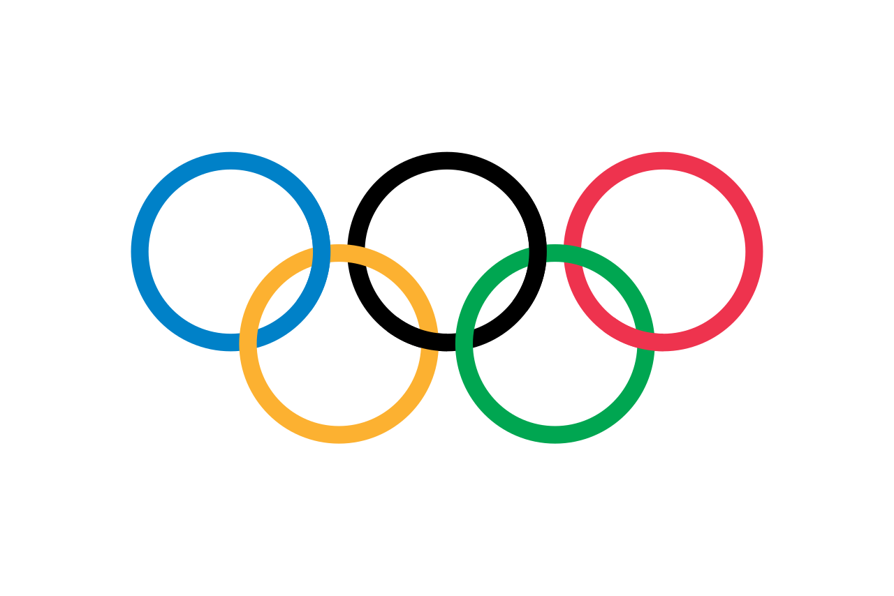

# 🏅 Olympics Data Analytics & LA 2028 Predictor (1896 – 2028)

[](http://localhost:8501)
[](https://www.python.org/)
[](LICENSE)

An interactive, end-to-end data science and machine learning web application built with **Streamlit**, **Pandas**, **Scikit-Learn**, and **Plotly**. Explore 128 years of modern Summer Olympic history (1896–2024) and forecast future medal tallies for **Los Angeles 2028**.

<p align="center">
  
</p>

---

## 🚀 Key Features

### 1. 🔮 Los Angeles 2028 Olympic Medal Predictor
- **Machine Learning Forecasting**: Built using a weighted time-series **Ridge Regression** model trained on modern Olympic cycles (1984–2024).
- **Comprehensive Projections**: Predicts exact breakdowns for **Gold 🥇, Silver 🥈, Bronze 🥉, and Total Medals** for any participating nation.
- **Momentum & Host Advantage**: Factors in recent momentum deltas from Paris 2024 and historic home-ground advantage for Team USA hosting in LA 2028.
- **Interactive Trajectory Curves**: Plotly trend charts highlighting historic performance curves alongside the projected 2028 forecast point.

### 2. 🌍 All-Time & Year-Wise Medal Tally
- Filterable by **Olympic Year (1896–2024)** and **Country / Delegation**.
- Official Olympic ranking tiebreakers (sorted by Gold 🥇, Silver 🥈, Bronze 🥉).
- **Interactive Choropleth World Map**: Visualize global medal distributions with rich hover cards.
- **Data Export**: One-click download of filtered medal tallies in CSV format.

### 3. ⚔️ Head-to-Head Country Comparison
- Compare any two countries side-by-side (e.g., *USA vs China*, *India vs Pakistan*, *UK vs France*).
- Comparative medal timeline charts showing historic dominance shifts.
- Detailed historical head-to-head data table.

### 4. 📊 Historic Overall Analysis
- Track grand totals: Editions, Host Cities, Sports, Events, Athletes, and Participating Nations.
- Growth trajectory lines for participating countries, athlete counts, and events over time.
- High-resolution interactive heatmap showing the density and introduction of events across sports.
- Most decorated Olympic athletes of all time and filtered by individual sport.

### 5. 🏆 Country-Wise Deep Dive
- Detailed trajectory curves showing a country's medal haul per edition.
- Quick metrics displaying total medals, best Olympic edition, and peak single-games performance.
- Sport specialization heatmap identifying disciplines where a nation dominates.
- Top 10 most successful athletes for any chosen nation.

### 6. 🏃 Athlete Demographics & Trends
- **Age Distribution**: Kernel density estimates comparing age profiles of gold, silver, bronze, and non-medalists.
- **Physique Explorer (Height vs Weight)**: Interactive scatter plot with athlete-level tooltips across sports and genders.
- **Gender Inclusivity**: Male vs Female participation progression over the decades.

---

## ⚡ Recent Upgrades & What's New

| Version / Feature | Description |
| :--- | :--- |
| **LA 2028 Predictor** | Machine learning forecasting engine using weighted Ridge Regression to predict 2028 podium finishes. |
| **Tokyo 2020 & Paris 2024 Data** | Updated with verified official IOC results for Tokyo 2020 and Paris 2024. |
| **High-Speed Caching** | Added `@st.cache_data` in Streamlit for instant zero-lag page navigation. |
| **World Map (Choropleth)** | Interactive global medal distribution heatmap. |
| **Head-to-Head Comparison** | Side-by-side comparative analysis between any two nations. |
| **Interactive Plotly Visuals** | Replaced static Matplotlib charts with zoomable Plotly visualizations. |
| **Data Exporter** | Export any filtered table directly as CSV. |

---

## 🛠️ Tech Stack
- **Frontend / Dashboard Framework**: Streamlit
- **Machine Learning & Modeling**: Scikit-Learn (Ridge Regression)
- **Data Processing & Wrangling**: Pandas, NumPy
- **Interactive Visualizations**: Plotly Express, Plotly Figure Factory, Seaborn, Matplotlib

---

## 📁 Repository Structure
```
├── app.py                      # Streamlit application with modern UI & tabs
├── helper.py                   # Analytics engine & LA 2028 ML predictor function
├── preprocessor.py             # Data cleaning, season filtering & one-hot encoding
├── athlete_events.csv          # Merged Olympic dataset (1896 - 2024)
├── noc_regions.csv             # 3-letter NOC to Country/Region mapping
├── requirements.txt            # Python dependencies (Streamlit, Scikit-Learn, Plotly, Pandas)
├── Procfile                    # Deployment configuration
└── README.md                   # Documentation, features & guide
```

---

## 💻 Getting Started

### Prerequisites
Make sure you have Python 3.9+ installed.

### 1. Clone the Repository
```bash
git clone https://github.com/sandeepsagar18/Medal_Olympics_Analaysis.git
cd Medal_Olympics_Analaysis
```

### 2. Install Dependencies
```bash
pip install -r requirements.txt
```

### 3. Launch the Application
```bash
streamlit run app.py
```
Open your browser at **`http://localhost:8501`**.

---

## 📄 License
This project is open source and available under the [MIT License](LICENSE).
